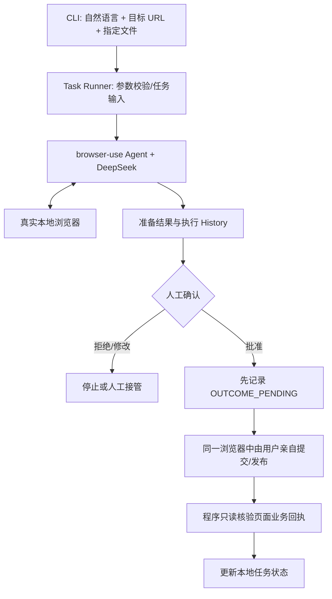

# Personal Web Agent — 开发规划与验收规范 v1.1

> 公开范围说明：本文保留开发目标和历史阶段依据；文中提到的 P*_REPORT.md 为仅本地保留的内部报告，不随源码发布。当前能力与运行方式以 README 为准；公开离线输入均为合成结构，不包含原始实采快照。

> 状态：P3-B 本地发布闭环、P3-C1 Edge/CSDN 只读检查已获人工验收；P3-C2A 仅进行 CSDN 离线适配。真实 Greenhouse、CSDN 写入仍保持 BLOCKED。  
> 日期：2026-10-30  
> 定位：个人 GitHub 工程实践项目，非论文创新、非商业 SaaS、非简历必选项目。  
> 技术主线：Python + 开源 browser-use Python Library + DeepSeek API + 本地可见浏览器。

## 0. 本文档如何使用

- 本文档是开发范围和分阶段验收依据；每阶段只允许 Codex 实现该阶段，不提前搭建未来模块。
- **协作分工**：用户在当前 ChatGPT 对话窗口控制开发节奏；ChatGPT 负责审查 Codex 的结果、识别问题并撰写下一条指令；Codex 负责实际改代码、运行测试和提交执行证据。
- 不得因为 Codex 声称 PASS 就自动进入下一阶段。
- 每轮开发结束后：Codex 给出变更清单、运行命令、关键测试证据、未解决问题；当前窗口审核后只能作出 PASS / FIX（同阶段修复）/ BLOCKED 三类判定，再决定下一条 Codex 指令。
- 若真实 browser-use 版本与本文档示意 API 不同，以安装版本的官方接口和运行验证为准，并在文档中记录差异；任何重大接口改变先报告而非自行换技术栈。
- 优先跑通可演示的真实浏览器操作，避免为了项目包装而开发复杂的通用框架。
- 默认不自动 git push、不发布真实内容、不向岗位提交测试性申请；真实外部操作必须由用户本人明确批准。

### 0.1 v1.1 审查修订点

- 将持久化记录/防重复的最小实现提前到 P2，解决原 P2 要求记录但 P4 才开发的阶段冲突。
- 细化 P1 的人工接管、同一浏览器会话保持与恢复核验；本地测试通过不等于任意真实网站都安全。
- 增加 OUTCOME_PENDING（结果尚待核验）以覆盖外部提交后、结果落库前的崩溃窗口。
- P1 只做招聘本地测试表单，图文发布测试页延后到 P3。
- 明确 browser-use 原生文件参数 available_file_paths、DeepSeek 的文本/DOM 兼容配置，以及登录态和隐私边界。

## 1. 项目目标

**Personal Web Agent** 允许用户以自然语言发起网页任务，在可见浏览器中由 LLM 决策并执行多步骤网页操作，完成指定内容的填写、附件上传、人工确认和结果反馈。

首版只支持两个具有代表性的场景：

1. **求职申请辅助**：打开用户指定的岗位申请页，读懂表单，用用户提供的资料填写字段，上传指定 PDF 简历，在最终提交前暂停交给用户确认；提交后核验回执并记录状态。
2. **图文内容发布**：打开用户有权操作的内容后台，填写标题、正文并上传指定图片，在最终发布前暂停交给用户确认；发布后核验结果和内容链接。

**希望展示的个人能力**：实际使用开源 Agent 框架、接入 LLM、处理真实浏览器任务、集成本地文件、调试网页异常、设计必要的人工控制，以及交付可运行可复现的项目。

**不宣称**：研发了比 browser-use 更强的浏览器模型、设计了新的 GUI Agent 算法，或者仅靠新增一次 LLM 检查就实现了“可靠性突破”。

### 1.1 MVP 成功标准

- 在本地安装后，可通过 CLI 以中文任务描述发起运行；打开真实可见浏览器并能看到操作过程。
- **一个**选定招聘平台：完成岗位页面到“申请待确认”的准备流程；在用户真正授权、真实业务允许的前提下，完成一次提交结果核验。
- **一个**选定图文发布平台：完成文章准备、图片上传、待确认，并在用户授权后完成一次发布结果核验。
- 至少在本地测试页面上验证：附件上传、停止审批、拒绝提交、重复任务提示、提交后无法确定结果这几类关键路径。
- 源码、配置示例、启动说明、测试命令和去敏演示材料齐全；个人密钥、真实简历及 Cookie 不进入 Git。

> “已填写”≠“已上传成功”≠“已提交成功”；这些状态必须分开描述。

## 2. 技术选型与职责边界

| 层次 | 技术 | 职责 | 我们是否重新开发 |
|---|---|---|---|
| 决策模型 | DeepSeek API（以实际可用模型为准） | 理解目标、选择网页操作 | 否，直接使用模型接口 |
| Agent 执行 | 开源 browser-use Python Library | 浏览器观察—决策—动作循环、常见网页操作 | 否 |
| 浏览器 | browser-use 的本地 Chromium/Chrome 控制 | 打开网页、导航、点击、输入、文件处理 | 否 |
| 任务入口 | Python CLI | 用户输入、任务类型、URL、文件路径和业务资料 | 是，薄封装 |
| 人工控制 | 简单的暂停/审批流程 | 防止未经批准的外部提交或公开发布 | 是，最小实现 |
| 任务记录 | P2 引入本地 SQLite | 结果查询、防重复、未知状态保留 | 是，最小实现 |
| 验证与日志 | browser-use 历史 + 少量业务页面检查 | 核验附件及提交回执，输出脱敏结果 | 少量补充 |

官方确认：当前开源库文档提供 Agent、ChatDeepSeek、浏览器参数、工具扩展和 Hook；Open Source Library 与 Browser Use Cloud SDK 是不同接口，本项目只选开源库，不混用 Cloud SDK 示例。

**接口核对与复用边界**（参考截至 2026-10-30 的公开文档，仍需 P0 用安装版本验证）：

- 模型：`from browser_use import Agent, ChatDeepSeek`，按 DeepSeek 当前官方 API 显式使用 `ChatDeepSeek(model="deepseek-flash")` 与 `DEEPSEEK_API_KEY`（P0-B 更新；旧示例 deepseek-chat 不再作为项目默认值）；不为了跟随新模型名称而擅自更换供应商。
- 文件：内置 `upload_file`；Agent 可通过 `available_file_paths` 声明本轮允许访问的文件。工具返回成功不等于目标网站完成上传；仍需检查网页状态。
- 安全约束：`Tools(exclude_actions=[...])` 可排除默认动作；`allowed_domains` 可限制导航范围；Hook 按 Agent 步骤级运行，不是对每次点击都能严格拦截的独立事务边界。
- 浏览器：使用独立、私有的 browser Profile 保存登录态；手动登录和验证码由用户处理。浏览器保持/接管能力需在 P1 真测。
- 视觉：首版按 DOM/可访问性信息工作；当前 browser-use 对部分 DeepSeek 模型仍自动禁用视觉，P0 明确 `use_vision=False`，不许假装已支持截图理解。
- `read_file`/`evaluate`/`send_keys` 等能力可能带来额外副作用，准备阶段不得只靠一条自然语言指令充当安全措施。

### 2.1 不做的事情

- 不 Fork / 改造 browser-use 内部执行循环；不自己写一套通用 Playwright Agent。
- 不设计 Multi-Agent、Planner/Executor/Verifier 多模型链；不加 LangGraph、MCP、向量数据库或长期记忆。
- 不做批量投递、自动岗位搜索、自动生成简历、自动写文章、多用户 SaaS、网站反爬绕过或验证码破解。
- 不把固定平台脚本硬编码成整个项目；必要的站点配置仅服务首版平台适配。
- 不把 LLM 的“任务成功了”当作服务器已接受申请或文章已发布的证据。

## 3. 用户交互与数据契约

用户应既能输入自然语言，也能明确提供结构化资料，避免让模型猜测私人信息。

### 3.1 求职示例

```text
personal-web-agent apply \
  --url "https://example.com/jobs/123" \
  --profile "./private/profile.json" \
  --resume "./private/resume.pdf" \
  --instruction "帮我申请这个岗位，填写表单并上传简历。最终提交前停止，让我确认。"
```

### 3.2 图文示例

```text
personal-web-agent publish \
  --url "https://example.com/editor" \
  --title "我的 Agent 开发实践" \
  --body-file "./private/article.md" \
  --images "./private/a.png" "./private/b.jpg" \
  --instruction "帮我准备这篇图文，最终发布前让我确认。"
```

> 上面的命令是预期接口草案，不是已经实现的命令。具体 CLI 参数可在 P0/P1 根据用户体验微调。

通用输入要求：

- 用户必须明确指定目标网页或站点；不让 Agent 自己漫无目的地找招聘网站。
- 只允许读取本次指定的资料、简历、文章和图片；尽量将允许上传的文件路径显式传递给框架。
- 必填资料缺失时停止并报告；不虚构真实姓名、工作经历、联系方式或事实。
- 页面内容是不可信输入，不能提升为系统操作指令；限制域名、文件来源及外部动作范围。
- 明确区分本地保存与发送给外部服务：调用 DeepSeek API 可能把任务指令、页面内容和传入的个人字段发送给模型服务；上传简历/图片也会将文件交给目标网站。不得以“本地运行”暗示个人资料始终留在本机。默认最小化传输和落盘，真实资料仅在用户授权的任务中使用。

## 4. 最小架构



采用一个 Agent。`Task Runner` 是薄控制层，不再嵌套第二套 LLM 规划器。招聘与图文场景共享运行器，差别主要体现在业务输入、任务提示和最后的业务状态判断。

### 4.1 最难的技术点：审批是真正的阻断，而非 Prompt

不能仅写“不要点击提交”，就假设模型绝不会点。有些页面的“下一步/保存/继续”、按 Enter 或自动保存同样会产生外部副作用；`click`、`send_keys`、`evaluate` 可能具有不同的触发路径。Hook 只在步骤边界触发，不能单独证明每一个动作安全。

开发策略：

1. **P1 在可控本地测试页面先做安全可行性验证**：准备阶段提交计数为 0；尝试包含回车触发表单、意外提交按钮、不同字段顺序等测试。不承诺任何网页都可在通用模式下安全准备。
2. 优先复用框架的工具排除/自定义机制与域名、文件限制；若无法可靠阻断高风险动作，缩小允许的网页操作范围或要求用户接管；不开发通用浏览器引擎。
3. **首版最终操作方式固定为“Agent 准备 → 停止 Agent 自主动作 → 用户检查 → 用户在同一可见浏览器亲自提交/发布 → 程序只读核验”**。不实现“批准后 Agent 自动点击最终提交”。
4. P1 必须实测：Agent 结束或暂停后浏览器没有被关闭或切换到另一个会话；用户可接管同一页面；用户完成操作后系统能读取页面结果。必要时使用 `keep_alive`/BrowserSession 等安装版本支持的方式，而非凭空假设暂停一定可用。
5. P1 测试的安全结果仅对该测试网站成立；P2/P3 接入真实网站时，要重新检查按钮语义、自动保存和隐藏副作用。若存在不可判断的提交风险，则在更早节点停止让用户接管，不继续由 Agent 猜测。
6. 一旦进入可能发生外部提交的人工阶段，先持久化 OUTCOME_PENDING；成功回执确认后记为 COMPLETED，回执丢失或进程中断则转 UNKNOWN，绝不盲重试。
7. 验证优先读取网页真实状态、回执、文章 URL；不以模型自行宣布“完成”作为最终依据。

## 5. 最小状态模型

无需自研工作流引擎，首版记录以下状态即可：

- `CREATED`：创建任务。
- `RUNNING`：正在执行网页操作。
- `REVIEW_REQUIRED`：准备完成，待用户审核。
- `OUTCOME_PENDING`：已进入可能产生外部效果的人工操作阶段，提交/发布是否实际发生、结果如何仍待核验；该状态持久化后必须按潜在已提交处理。
- `COMPLETED`：有外部成功证据确认完成。
- `CANCELLED`：用户取消，确认没有最终提交动作。
- `FAILED`：已知失败且未提交。
- `UNKNOWN`：提交是否成功不能确定，必须人工查询后再决定。

每个任务至少记录：本地任务 ID、场景类型、站点、目标 URL、创建/结束时间、当前状态、页面成功证据摘要（如回执文本/内容 URL）、错误类别。不在常规日志中写完整个人资料、原始表单、Cookie、密钥。

重复判断：招聘以平台 + 公司/岗位 ID（若能获得）+ 用户标识等组合；发布以站点 + 账号 + 正文/图片内容摘要等组合。无稳定 ID 时提示“可能重复”，不要误称绝对去重。

**实现时机**：P1 可只保留内存状态与测试端点计数；P2 开始加入最小 SQLite 持久化与去重检查（避免 JSONL 读写竞争及状态覆盖），P3 复用；P4 只加边界测试和必要修复，不另造任务调度系统。

**恢复原则**：如果进程在 REVIEW_REQUIRED 与人工操作之间中断，先询问用户是否已操作并核对页面；OUTCOME_PENDING 或 UNKNOWN 绝不可自动重新提交。只有确认未发生外部提交时，才可以按人工选择重新开始。

## 6. 分阶段开发计划

### P0 — 项目初始化 + DeepSeek/browser-use 真实 Smoke

**目的**：先证明模型确实在真实浏览器里完成动作，不先写业务模块。

**Codex 工作**：

- 检查系统、Python、uv；推荐 Python 3.12，创建虚拟环境并安装开源 browser-use；锁定经过验证的依赖版本。
- 接入官方 `ChatDeepSeek(model="deepseek-flash")`（具体可用模型及参数由实际安装版本核验）；`DEEPSEEK_API_KEY` 从本地环境读取；首轮配置 `use_vision=False`。
- 启动可见浏览器，在一个公开、无需登录的网站执行两步以上的安全操作（导航 / 链接点击 / 读取页面信息）。
- 输出 Agent History、访问 URL、完成情况和异常；如果安装版本支持可记录 Token/成本，否则标记“不支持/未采集”；基础 README、`.gitignore`、`.env.example`。

**明确不做**：任务数据库、用户资料、自动招聘、内容发布、Web UI。

**通过标准**：真实 DeepSeek API 调用 + 真实浏览器操作有证据；失败时真实报错，不允许 Mock 冒充。CLI 能复现 Smoke。

**交付证据**：运行命令、库版本、脱敏日志和一次成功的运行记录。

### P1 — 本地可控表单 E2E + 人工审批边界

**目的**：在可控环境中验证输入字段、文件上传、页面核验和审批约束，先不碰真实招聘申请提交。

**Codex 工作**：

- 创建极简招聘测试表单（本阶段不做图文编辑）：姓名/邮箱/文本/PDF 上传、最终提交按钮、提交回执、服务端提交计数，并提供字段顺序变化模式。
- 给 CLI 加最小任务输入：URL、用户资料、文件路径、自然语言指令。
- 用 browser-use 对测试表单自主填写与上传，保存可核验的字段/文件状态；使用安装版本实际支持的 available_file_paths 仅开放指定文件。
- 实现或验证“准备阶段不可触发提交端点”的控制方式；测试拒绝、按 Enter 等意外提交路径和手动接管；确保同一个浏览器会话能由人完成最后点击，再由程序读取回执。
- 先使用文件路径白名单及目标域名限制，避免访问无关个人文件；不要默认把真实个人资料发送到测试站点/外部 LLM，优先使用虚构测试资料。

**明确不做**：大量异常框架、统一跨站点规则引擎、真实网站最终提交。

**通过标准**：

- 测试招聘表单正确填写，PDF 上传状态明确；
- 不同字段顺序下仍能完成，不能只依靠固定的 CSS selector；
- 未经批准，测试站点提交计数始终为 0；
- 用户取消后没有外部提交；同一浏览器会话中的人工接管、人工最终点击和程序核验能够完成；
- 如果准备阶段仍可能误提交、或用户无法接管同一会话，记录 blocker，停止进入 P2 的真实申请。

**交付证据**：测试页面提交计数、运行 History、至少一次“拒绝审批”测试。

### P2 — 真实招聘平台：一个岗位申请流程

**入口条件**：P1 审批边界与会话接管均通过；用户选定一个可正常使用且允许本人申请的招聘网站及岗位，准备真实资料与 PDF。

**Codex 工作**：

- 选择一个具体平台的岗位申请页（例如某个 Greenhouse 托管页只是候选，不提前承诺兼容），实测表单结构和文件上传方式。
- 复用 P1 的 Agent Runner；少量编写该站点的输入/结果检查，不重写浏览器逻辑；先检查该站点是否存在自动保存、误提交等副作用。
- 完成“打开岗位→识别表单→填写→上传→检查→停止待确认”。
- 用户明确批准后，先持久化 OUTCOME_PENDING，由用户在同一浏览器亲自完成最终提交；Agent 自主动作保持停止，程序只负责只读核验回执、记录状态。
- 本阶段加入最小 SQLite 状态记录和去重查询；对相同岗位再次运行时提示可能重复，尤其 OUTCOME_PENDING/UNKNOWN 不允许直接重试。

**明确不做**：批量真实投递、岗位爬取、多平台兼容、自动生成申请内容。

**通过标准**：至少一次合法的真实申请准备流程；实际提交仅在用户希望申请该岗位时进行；有提交回执则记录 COMPLETED，没有回执则记录 UNKNOWN，不得宣称成功；可从 SQLite 查询记录并拦截重复。若没有真实申请需求，可验收“准备 + 本地完整提交链路”，但 P2 的真实提交验收标为未覆盖，不得伪称通过。

**交付证据**：脱敏 Trace、允许公开的局部截图（如有）、实际申请状态与异常说明。不得为了测试向无关岗位提交虚假信息。

### P3 — 图文发布：第二个真实场景

**入口条件**：P2 的公共 Runner、会话接管、记录能力已通过；用户选定一个有权限的内容平台（推荐先考虑自己控制的 WordPress 测试站点，具体后定）。如果 P2 因没有合适真实岗位而未做外部提交，只要本地提交闭环已过，仍可推进 P3，但必须保留 P2 未覆盖项。

**Codex 工作**：

- 先在 P1 的 fixture 服务新增最小图文发布测试页（标题、正文、图片、发布计数），通过安全准备与人工发布测试，再接入真实内容后台；扩展任务输入：标题、正文文件、图片路径。
- 复用同一个 browser-use Runner、人工接管、文件限制和 P2 的 SQLite 记录方式；不新增一套 Agent。
- 完成“进入编辑页→填写标题/正文→上传图片→页面核验→人工确认→用户手动发布→只读核验结果”；用户确认前不得触发真实公开发布。
- 处理登录过期、富文本编辑器无法填写、图片异步上传三类真实阻碍；遇到验证码人工处理，不绕过。

**明确不做**：自动生成内容、多账号分发、定时批量发布。

**通过标准**：在用户自己的测试账号/站点完成至少一次图文发布，内容标题、正文和图片得到页面核验；最终公开发布有用户明确授权；能记录文章 URL 或未知状态。

**交付证据**：经用户许可公开的演示，发布文章链接（若适宜公开），脱敏运行记录。

### P4 — 最小可靠性补强 + GitHub 发布准备

**目的**：完善真实使用体验、消除明显问题、打包成别人可以复现的项目。

**Codex 工作**：

- 根据 P2/P3 已观察到的失败情况做最小修复（不要预设复杂故障分类器）。
- 基于 P2/P3 已有持久化记录补充去重测试、可读脱敏日志；网络断开但可能已提交时使用 UNKNOWN，不再新建另一套 Store。
- 测试：资料缺失、附件缺失或上传失败、登录中断、拒绝审批、重复任务、提交后回执丢失。
- 补 README：架构边界、安装命令、两类任务示例、隐私与安全说明、局限、演示 GIF/视频（可选）。
- 做 Git 发布前审计：API 密钥、浏览器 Profile、Cookies、真实简历、照片、原始截图、个人信息、版权许可。

**通过标准**：从干净环境按 README 能完成 P0 的公开 Smoke 和本地表单测试；真实网站示例可重现（如外部网页未变化）；未携带秘密信息；测试和基础静态检查通过。

**交付证据**：README、测试结果、版本清单、演示记录、最终风险清单。

## 7. 验收测试矩阵（小而可重复）

| 编号 | 用例 | 预期结果 | 环境 |
|---|---|---|---|
| T01 | 打开公开网页、点击链接、读取标题 | Agent/浏览器真实操作 | 公开网页 |
| T02 | 表单字段顺序变化后填写资料 | 自主识别对应字段 | 本地 fixture |
| T03 | PDF 上传（P1）及图片上传（P3） | 页面能识别已上传文件，失败不谎报 | 本地 fixture |
| T04 | 准备阶段诱导点击提交/按 Enter 等 | 后端提交计数 = 0；失败则阻断真实站点阶段 | 本地 fixture |
| T05 | 用户取消任务 | 无最终提交，任务结束 | 本地 fixture |
| T06 | 人工提交后响应丢失/进程中断 | 先记录 OUTCOME_PENDING，恢复时为 UNKNOWN 或先核对，不得自动重试 | 本地 fixture |
| T07 | 重复运行同一申请或文章 | P2/P3 持久化记录可查；提示/拦截重复操作 | 本地 fixture |
| T08 | 实际招聘岗位准备；若有真实申请需求则授权提交 | 有网页回执，或明确标记 UNKNOWN；无实际申请需求则记录未覆盖 | 用户本人实际岗位 |
| T09 | 实际文章准备 + 用户授权发布 | 页面确认状态/URL，或明确标记 UNKNOWN | 自有内容平台 |
| T10 | Agent 停止后人工接管同一浏览器 | 人工提交后，程序能读取同一页面结果 | 本地 fixture |

测试重点是能否真实操作、能否按边界停止，以及是否保留正确结果；不需要为个人项目设计论文式的大规模对照实验。

## 8. 建议的轻量仓库结构（按需逐步形成）

```text
personal-web-agent/
├── README.md
├── DEVELOPMENT_PLAN.md           # 本文档
├── pyproject.toml
├── uv.lock                       # 环境建立后生成
├── .env.example
├── .gitignore
├── src/personal_web_agent/
│   ├── __init__.py
│   ├── cli.py                    # P0/P1：命令行入口
│   ├── runner.py                 # P0：browser-use / DeepSeek 封装
│   ├── task_inputs.py            # P1：资料与文件输入
│   ├── approval.py               # P1：安全边界、同会话人工接管
│   ├── records.py                # P2：最小 SQLite 状态记录；P4 补测试
├── tests/
│   ├── fixture_site/             # P1：本地测试表单和计数端点
│   └── ...
└── .local/                       # 私有资料/Profile/日志，不提交 Git
```

> 文件名和拆分是建议，不是必须。先做功能，再根据实际耦合度拆文件，不要为不存在的未来能力预建大量目录。

## 9. 关键风险和处理方式

| 风险 | 影响 | 处理 |
|---|---|---|
| DeepSeek 与 browser-use 动作 schema 兼容性 | 模型无法正确调用浏览器动作 | P0 真实验证并锁依赖；必要时最小修复 |
| DeepSeek 当前浏览器视觉接口限制 | 纯视觉/Canvas 页面可能不可用 | 首版选择 DOM 可交互页面；明确限制 |
| browser-use 能执行点击，但不理解业务副作用 | 可能误提交或自动保存 | P1 先验证提交拦截；不足则人工完成最后动作 |
| 不同站点登录和动态表单差异 | 场景不稳定 | 首版只选两个站点；人工登录，逐站验证 |
| 截图/历史中包含个人信息 | Git 泄漏风险 | 默认本地保存、最少记录、脱敏，忽略私有目录；传给 DeepSeek 的页面/个人字段也属于外部数据传输 |
| 网站政策或授权限制 | 账户风险 | 仅操作用户有权使用的账号和页面；遵守平台规则 |
| LLM 成本与任务循环 | 时间和费用上升 | 最大步骤数/超时/失败上限，记录调用量和成本 |

## 10. 每阶段交给 Codex 的工作方式

使用一阶段一指令、一阶段一验收，不要一次性让 Codex 写完 P0–P4。每次指令从以下模板派生：

```text
请阅读仓库 DEVELOPMENT_PLAN.md，只实施其中的 P{N} 阶段。
技术约束：开源 browser-use Python Library + DeepSeek API + Python；
直接复用框架，不重复实现底层、不引入 LangGraph / Multi-Agent / Web 前端。

先检查已有代码和当前安装依赖版本，再进行最小修改。
本轮仅实现 P{N} 的目标、测试及必要文档；不抢做下一阶段。
必须遵守提交前人工确认与个人数据保护约束。

完成后请给出：
1. 当前分支/工作区状态，以及代码变更文件清单与关键实现说明；
2. 实际执行的命令、依赖版本和测试结果；
3. 对照本阶段每条验收条件的 PASS/FAIL 与可复核证据（日志路径、页面状态、服务端计数等）；
4. 对个人信息/密钥/浏览器 Profile 的保密检查；
5. 已知限制、下一阶段的阻断问题和必须由用户人工完成的步骤。
不得把 Mock 测试描述为真实网页测试；不得自动 Push、不得未经指令切换到下阶段。
```

**P0 专用补充**：浏览器必须真实启动并操作公开无登录网页，不创建业务模块。

**P1 专用补充**：使用本地招聘 fixture 验证字段/PDF/“未授权提交计数=0”和同一浏览器人工接管 + 结果回读；未通过不得进入真实网站。

**P2 专用补充**：只适配选定的一个求职平台；加入最小 SQLite 记录；真正提交需用户亲自操作，禁止测试性乱投。

**P3 专用补充**：先用本地图文 fixture 测，再复用 P2 现有能力扩展一个自有内容平台，真正发布需用户亲自操作。

**P4 专用补充**：只修真实暴露的问题并完成 GitHub 发布准备；是否 Push 由用户另行明确授权，不再添加新平台。

## 11. 目前尚待确定，不阻碍 P0 的事项

1. **实际开发机器 / 系统**：P0 中 Codex 检查环境后确定本地 Chromium/Chrome 连接方式。
2. **招聘平台**：P1 本地测试通过后，再根据本人确实需要申请的岗位选择；不因 Demo 需求制造虚假投递。
3. **内容平台**：优先拥有测试权限的站点，P2 后再决定。
4. **保存方式**：P0/P1 不引入数据库；P2 因实际需要防重复和处理中断状态，直接选择最小 SQLite（不做复杂 ORM / 迁移系统）。
5. **审批拦截能力**：这是 P1 必须通过的 feasibility gate；如果准备阶段仍无法安全限制动作，则缩小 Agent 操作边界并提前交给用户接管，不假装已解决。

## 12. 参考资料（官方）

- Browser Use Open Source 与 Cloud 产品边界：https://browser-use.com/llms.txt
- Browser Use 开源库 Quickstart：https://docs.browser-use.com/open-source/quickstart
- DeepSeek 原生集成示例：https://docs.browser-use.com/open-source/supported-models
- 浏览器配置/Profile/域名限制：https://docs.browser-use.com/open-source/customize/browser/all-parameters
- 自定义工具入口：https://docs.browser-use.com/open-source/customize/tools/basics
- Agent 生命周期 Hook：https://docs.browser-use.com/open-source/customize/hooks
- 源码仓库：https://github.com/browser-use/browser-use

---

**执行原则总结：** 先真正跑通浏览器，再跑通可控表单与同会话人工接管，再接真实招聘网站（同时实现最小持久化），再复用到图文发布，最后按实际问题补齐测试和文档。核心是个人工程实践，不是为展示“创新”而重复造轮子。


### 本轮阶段细分：P2-A（2026-11-02）

按用户本轮范围，仅实现标准库 sqlite3 Task Store、apply-prepare --handoff 状态接入、CLI 查询和离线 fixture 回归。
状态和去重规则沿用第 5 节。先完成 OUTCOME_PENDING 的持久化再开放人工提交；中断未确认状态一律阻止自动重试。
P1 已通过人工验收，证据见 P1_C1_REPORT.md；P2-A 实现及离线证据见 P2_A_REPORT.md。
P2 的真实平台选定、真实资料、真实申请/提交仍未覆盖，本轮不将其标为 P2 全阶段通过。


### 本轮阶段细分：P2-C1（2026-11-02）

仅对 Greenhouse/Sertis/7847750002 增加基于 P2-B 快照的资料匹配、下拉选项绑定、稳定身份去重及 CLI 离线校验。
抽出 fixture 专用状态观察与验证函数，共享唯一 Browser/Agent Runner，不引入 Adapter 框架。
P2-B 尚未证明自动保存、上传与最终提交隔离可控，因此真实 Greenhouse 分支在浏览器/模型启动前强制 BLOCKED。
不以离线字段匹配或 fixture 计数冒充真实 Greenhouse 准备/上传/提交成功。验收证据与未覆盖项见 P2_C1_REPORT.md。


### 本轮阶段细分：P3-A（2026-11-02）

用户明确停止扩展 P2，仅增加同一 fixture 服务的本地图文页、PNG/JPEG 多图上传、显式草稿保存、预览、单次授权发布和文章详情。
复用既有控制凭据、单 worker 计数与保护方式；不新增 Agent Runner、人工审批框架或 SQLite。
P2 真实招聘写入继续 BLOCKED，不把离线结果当作真实平台已通过。P3-A 仅为后续复用执行器/人工接管/任务记录准备环境，证据见 P3_A_REPORT.md。


### 本轮阶段细分：P3-B（2026-11-02）

只将本地图文 fixture 接入原 Runner、approval.handoff 和 SQLite，新增 publish-prepare 薄 CLI、图文观察/验证及内容去重。
不进入 WordPress。原生 upload_file 逐张上传，通过页面追加及图片 sha256 验证，不新开发上传工具。
真人取消及发布必须由用户执行；记录一次误以 approve/done 已完成发布的 UNKNOWN，不删除或改写。
P3_B_REPORT.md 区分离线协议、真实模型准备和真人点击证据；不因本地通过而宣称真实发布平台兼容。

### 本轮阶段细分：P3-C2A（2026-11-02）

真实平台由用户确定为 CSDN，使用 macOS Edge 独立 Profile 和回环 CDP；P3-C1 只读检查已获验收。
仅增加 CSDN 输入/结构识别、原 Agent 提示契约、Edge 参数复用、结果 URL 解析及原 SQLite 的账号/内容去重适配。
复用 publish-prepare 离线入口和唯一 Runner；CSDN 实际执行在浏览器、模型、审批或任务创建前强制阻止，不提供解锁开关。
本轮不调用模型、不操作或关闭现有 Edge Profile。自动保存属于真实草稿写入，后续必须先取得明确授权并验证动作边界。
最终发布只能由本人完成；不复用 fixture 服务端保护到 CSDN。离线通过不代表真实准备、上传、人工发布和回执已通过。
证据、未覆盖项及下一阶段条件见 P3_C2A_REPORT.md。

### 本轮阶段细分：P3-C2B（2026-11-02）

用户确认 P3-C2A 离线验收通过。仅准备指定测试文章与合成图片；真实运行前另行获得明确草稿/自动保存、图片上传及必要模型传输授权。
默认保持阻止；显式 --allow-csdn-draft 不包含最终发布。复用原 Agent 循环、SQLite 和同页人工检查，不新增执行引擎。
准备成功仅记 REVIEW_REQUIRED，不将云端草稿误判为正式发布；遇账号/验证码/兼容问题停止，不重复消耗模型。
附加独立 Edge 后只断开、不 kill、不删除 Profile。当前进度和证据见 P3_C2B_REPORT.md，不因离线测试通过宣称真实操作通过。

P3-C2B 实际进度：用户已明确批准后执行一次，在编辑器预检阶段保护性停止；未调用模型、未执行输入/上传，SQLite 为 UNKNOWN。真实准备/草稿核验未通过，不自动重跑；证据见 P3_C2B_REPORT.md。

P3-C2B-R2（2026-11-06）仅做预检/异常清理最小修复及离线回归，不连接真实 CSDN 或调用模型。
精确默认模板识别不解除既有草稿 ID 保护；原 UNKNOWN 不修改。原生冻结/断开顺序只有离线证据，真实恢复仍须人工核对与后续授权。
本轮证据及未满足的重跑条件见 P3_C2B_R2_REPORT.md。
