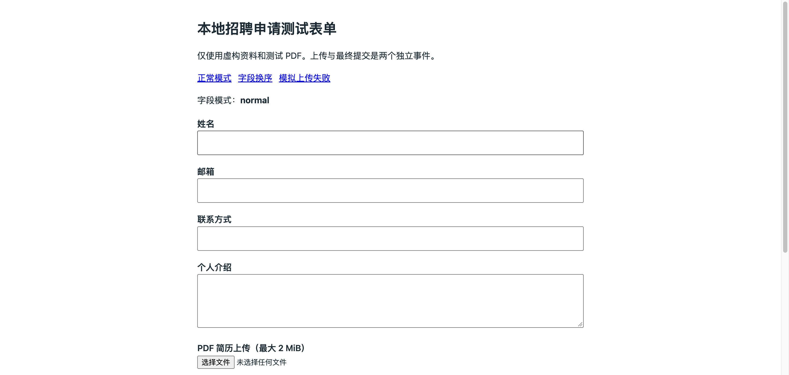
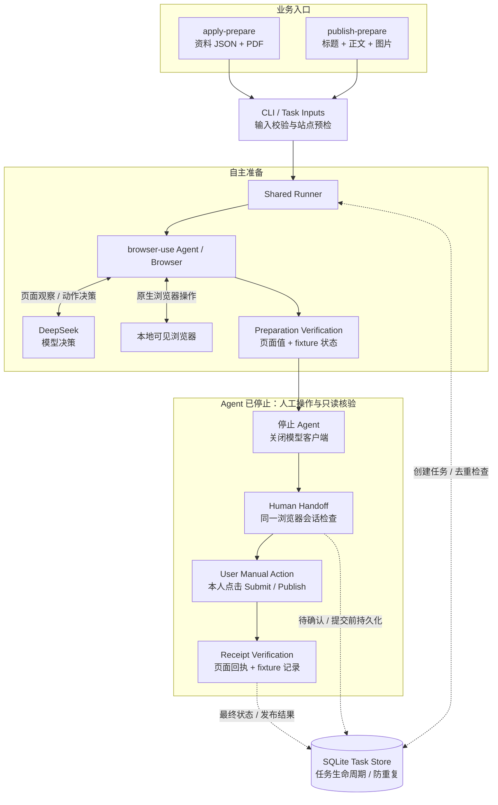

# Personal Web Agent

基于 DeepSeek 与 browser-use 的本地网页任务 Agent：在可见浏览器中准备求职表单和图文内容，将最终提交交还用户。

## Overview

从资料填写到附件上传，一次网页任务还需要确认页面是否接受了输入、何时停止自主操作，以及中断后是否可以重试。Personal Web Agent 将这些环节串成一条可检查的执行链路：**自然语言任务 → 浏览器自主准备 → 独立结果核验 → 人工接管 → 回执与状态记录**。

项目使用 Python CLI 组织业务输入，复用一个 browser-use Agent 执行循环，并用 SQLite 保留任务生命周期。当前完整运行示例面向本地可控测试网站，真实平台适配仍有限。

## Use Cases

| 场景 | 明确输入 | Agent 准备与核验 | 用户最终操作 |
| --- | --- | --- | --- |
| 求职申请辅助 | 目标 URL、资料 JSON、PDF 简历、自然语言指令 | 自主识别并填写字段，上传指定 PDF，核对字段值与服务器上传状态 | 检查原页面，亲自点击 Submit |
| 图文发布辅助 | 目标 URL、标题、正文文件、图片路径、自然语言指令 | 填写内容、逐张上传图片、核对预览并保存草稿 | 检查原页面，亲自点击 Publish |

两条流程在本地 fixture 使用合成资料、文章及图片。不会自动生成申请经历或改写用户提供的文章，也不会代替用户执行最终提交或发布。

## Demo



演示基于本地合成招聘 fixture：DeepSeek + browser-use 准备表单，Agent 停止后由用户本人确认并点击 Submit。GIF 按真实页面截图顺序制作、压缩等待时长，并非连续录屏；CLI 人工确认不在画面中显示。**不代表真实招聘平台投递成功。**

画面保留了本轮 **3 次提交尝试、1 次成功**：未授权及重复点击被 fixture 拒绝，因此成功回执与拒绝提示会同时保留。这一保护仅属于本地测试站。[查看静态回执截图](docs/assets/apply-demo-receipt.png)。

## Architecture



图示为本地两场景带 `--handoff` 的完整链路；虚线表示状态读写，SQLite 不执行浏览器动作。准备核验是 Python 校验函数，不是额外 Agent。求职接管任务及发布任务使用 Task Store；真实站点未通过完整链路验收，不能直接套用图中的 fixture 回执和服务端授权保护。

技术栈：**Python 3.12 · uv · browser-use 0.13.14 · DeepSeek `deepseek-flash` · SQLite · 本地 Chrome**。本地测试站使用 Starlette/Uvicorn；模型按 DOM 工作，显式设置 `use_vision=False`，不使用 Browser Use Cloud。

## Key Engineering Features

- **共享执行链路。** 两个 CLI 入口将业务输入交给同一个 [Runner](src/personal_web_agent/runner.py)，复用模型、浏览器生命周期、预算与人工接管；字段与结果差异由少量业务模块处理。
- **模型决策与原生执行。** DeepSeek 根据页面观察选择动作，browser-use 完成输入和原生 `upload_file`。指定文件白名单、工具排除和场景动作校验缩小操作范围，避免将完整流程写成固定 CSS 脚本。
- **准备结果独立核验。** 执行前检查目标、输入和站点状态；准备后比对页面值及 fixture 服务器记录。求职核对上传 ID/状态，发布还核对图片 SHA-256、顺序、预览及草稿，不仅依赖模型自述成功。
- **Agent 停止后人工接管。** 准备通过后停止 Agent、关闭模型客户端，保留同一页面；用户亲自检查并最终点击，程序只读核验回执。fixture 另有绑定上传/草稿的单次授权保护，不能推广为真实网站的通用提交拦截。
- **持久化与防重复。** [Task Store](src/personal_web_agent/records.py) 用 SQLite 事务创建任务、检查去重标识并校验状态转换。人工进入可能提交阶段前先写入 `OUTCOME_PENDING`，成功证据确认后才记录 `COMPLETED`；发布成功保存文章 ID/URL。
- **保守处理失败与不确定结果。** 请求、步数、连续失败与超时均有上限；无法核实结果时保留 `UNKNOWN` 并阻止自动重跑。已知无最终提交的失败/取消，也须人工核对并显式确认后才能重新执行。

## Quick Start

已验证环境为 **macOS arm64、Python 3.12 与可见 Google Chrome**，需要桌面登录会话；浏览器启动使用 macOS 应用路径。Windows/Linux GUI 执行尚未适配。以下命令均在项目根目录执行。

### 1. 安装与离线测试

已有 uv 时：

```sh
uv python install --no-bin 3.12
uv sync --locked --group fixture
.venv/bin/python -m unittest discover -s tests -v
```

离线测试不需要 API Key，不调用模型或真实网站。uv 本地安装、缓存配置及基础导入检查见 [使用指南](docs/USAGE.md)。

### 2. 配置模型并启动本地 fixture

```sh
# 仅首次创建；已有 .env 时不要覆盖
cp -n .env.example .env
chmod 600 .env
# 用本地编辑器填写 .env 中的 DEEPSEEK_API_KEY

# 在一个终端保持服务运行，勿对公网开放
.venv/bin/python -m uvicorn fixture_site.app:app --app-dir tests --host 127.0.0.1 --port 8000 --workers 1
```

打开求职页 <http://127.0.0.1:8000/> 或图文页 <http://127.0.0.1:8000/publish/>。下面两个 Agent 示例会消耗 DeepSeek API 额度，并将必要的输入及页面观察发送给模型服务；只使用生成的合成内容。

### 3. 求职表单与 PDF 上传

在另一个交互终端执行：

```sh
.venv/bin/python tests/fixture_site/sample_resume.py
.venv/bin/personal-web-agent apply-prepare --handoff \
  --url http://127.0.0.1:8000/ \
  --profile tests/fixture_site/synthetic_profile.json \
  --resume .local/fixture-resume.pdf \
  --instruction '识别字段，填写合成资料并上传指定 PDF，核验后停止，等我亲自提交。'
```

### 4. 图文编辑与多图上传

同样在交互终端执行，先确保图文 fixture 为空：

```sh
.venv/bin/python tests/fixture_site/sample_article.py
.venv/bin/personal-web-agent publish-prepare --handoff \
  --url http://127.0.0.1:8000/publish/ \
  --title '本地发布测试：合成文章' \
  --body-file .local/publish-fixture/body.txt \
  --images .local/publish-fixture/fictional-1.png .local/publish-fixture/fictional-2.png \
  --instruction '填写合成内容，上传图片并核验预览，保存草稿后停止，等我亲自发布。'
```

两个示例都先等待 CLI 确认 Agent 已停止：输入 `approve` → 等待授权成功 → **本人在原浏览器点击 Submit / Publish** → 看到成功回执后回终端输入 `done`。输入 `cancel` 不会自动提交；`approve` 本身也不会代点。完整步骤、状态查询及安全重跑规则见 [使用指南](docs/USAGE.md#handoff)。

## Validation & Limitations

- **本地 E2E 已有历史验收记录：** 两个场景均经过真实 DeepSeek/browser-use 准备及用户本人操作验证，覆盖字段/PDF、图文/多图上传、人工取消、最终点击与回执核验。**121 项自动化测试通过（历史验收）**，覆盖输入、协议、状态与异常路径；不等同于每次运行都重新完成真人 E2E。
- **Greenhouse：** 真实页面只读检查与离线资料匹配已完成；真实填写、上传和投递尚未验证，写入分支保持阻断。公开测试使用原创合成结构，不是实采网页。
- **CSDN：** 独立 Edge 会话只读检查与离线适配已有验证；真实编辑、图片上传、草稿核验及发布未完成验收。实验草稿入口默认阻断，授权草稿不包含最终发布，自动保存也属于外部写入。
- **能力范围有限：** 不支持任意招聘网站或内容平台；fixture 服务端保护不能保证第三方网站无误提交。SQLite 不恢复浏览器会话，也不提供远端 exactly-once 保证。
- **数据与许可：** 模型调用可能传输输入和页面信息，History 不等于完全匿名；密钥、Profile、数据库和原始日志须保持私有。**本仓库没有提供 LICENSE**，第三方依赖适用各自许可证。

## Documentation

- [使用指南](docs/USAGE.md)：安装、CLI 参数、模型预算、人工步骤、任务状态、异常与隐私说明。
- [本地 fixture](tests/fixture_site/README.md)：测试模式、独立上传/提交计数与单次授权协议。
- [合成测试输入](tests/snapshots/README.md)：数据来源与离线验证边界。
- [开发规划](DEVELOPMENT_PLAN.md)：设计约束与分阶段验收标准；历史内部报告不随仓库公开。
